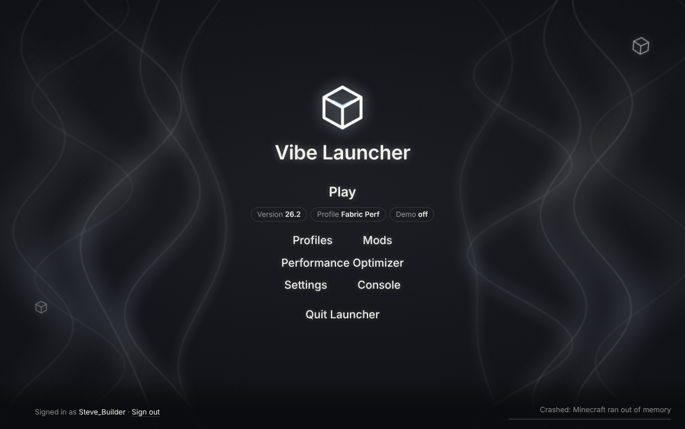

# Vibe Launcher 2.0

A standalone launcher for Minecraft: Java Edition 26.x and newer, in the same spirit as Prism: its own app window, its own Microsoft sign-in, and it installs and starts the game itself.

## Run it

**As an app (Windows):** double-click **build_exe.bat** once. It makes `dist\Vibe Launcher\Vibe Launcher.exe` (about 26 MB, no Python needed to run it). Keep the whole `Vibe Launcher` folder together; pin the .exe to Start or the taskbar.
**From source:** double-click **Start Vibe Launcher.bat**, or run `python3 launcher.py` (Mac/Linux too). Needs Python 3.10+; the first run installs `minecraft-launcher-lib` and `pywebview`.

Vibe opens in its own frameless window with its own title bar (WebView2, built into Windows 11). Opening it again brings the existing window to the front. Closing the window quits; if Minecraft is still running it keeps running. `--browser` uses a browser app window instead.

## Signing in (one-time Azure setup)

Vibe signs you in itself: it shows a short code, you enter it at **microsoft.com/link** (any browser, even your phone), and Vibe finishes the sign-in. Microsoft requires every launcher to use its own registered app, approved by Mojang, so you need one for Vibe:

1. Azure portal → **App registrations** → **New registration**. Any name; account type **Personal Microsoft accounts only**.
2. **Authentication** → turn on **Allow public client flows** → Save.
3. Copy the **Application (client) ID** into **Settings → Microsoft sign-in** in Vibe.
4. Apply for Minecraft API access at https://aka.ms/mce-reviewappid. Until it's approved, sign-in stops with "isn't approved for the Minecraft API yet".

Vibe never starts the game without a verified sign-in: right before every launch it re-checks your account with Microsoft, Xbox and Minecraft, including that you own the game, and stops if any step fails. There's no offline or no-account mode.

Until your app is approved, you can switch **Settings → How Play starts the game** to *Hand off to Mojang's Minecraft Launcher*: Vibe still installs the version, mods and performance settings, adds a "Vibe · <profile>" installation there, and you press Play in Mojang's launcher.

Your sign-in is encrypted with DPAPI on Windows (keyring on Mac/Linux) and tokens never appear in logs.

## What's new in 2.0

- **Its own app.** Native window, custom title bar (minimize, maximize, close), app icon, single instance, and a build script for a standalone .exe.
- **Launches the game itself** by default (Quick Play straight into servers), instead of handing off to Mojang's launcher.
- **In-app Microsoft sign-in** with a device code, with plain-language errors (no Xbox profile, child account, app not approved, doesn't own the game...).
- **Same look everywhere.** Every dialog (sign-in, confirmations, crash help) uses the launcher's own style; no browser pop-ups.
- Fix: on Windows, Vibe now takes its local port exclusively, so a second copy (or another program) can't share it.

## Servers (1.2)

- A list of survival servers with live status: player count, ping, server icon, description and version. Filter by name or mode.
- **Join** starts the game and connects straight to the server. In the hand-off mode, the server goes to the top of the profile's in-game Multiplayer list instead.
- Add your own (`play.example.net`, `host:port`, IPv4/IPv6; SRV records are followed). Your existing `servers.dat` entries are kept, and the old file is backed up to `~/.vibelauncher/backups/servers-dat/`.
- Suggested servers are third-party networks; Vibe isn't affiliated with them.

## Also in Vibe (1.1)

- **Profiles** with their own version and loader (Vanilla, Fabric, NeoForge, Forge); modded profiles get their own folder.
- **Mods** from Modrinth, checked for your exact version and loader, dependencies added automatically, SHA-512 verified.
- **Performance Optimizer** with hardware detection, RAM advice and presets; every Apply can be undone.
- **Crash help** that explains the likely cause in plain language.
- Faster repeat launches, offline version list, compact mode.

## Honest notes on performance

- The biggest FPS gains come from **Sodium** (make a Fabric profile) and a sensible **render distance**.
- JVM flags mostly reduce **stutter**; they don't raise average FPS much. More RAM than needed doesn't raise FPS.

## Files

- `launcher.py`: local server (127.0.0.1 only), native window, launching, profiles, optimizer.
- `ui.html`: the interface. `assets/`: app icon (`tools/make_icon.py` draws it).
- `vibe_core/`: sign-in (`msauth.py`), servers, mods, hardware, crash analysis, backups, secure storage.
- `build_exe.bat`: builds the .exe. Set `VIBE_DIST` to choose the output folder.
- `tests/`: `python -m unittest discover -s tests -v`.
- `~/.vibelauncher/`: settings, backups, trash, encrypted sign-in, `launcher.log` (the .exe's output).

Not affiliated with Mojang, Microsoft or Modrinth.
